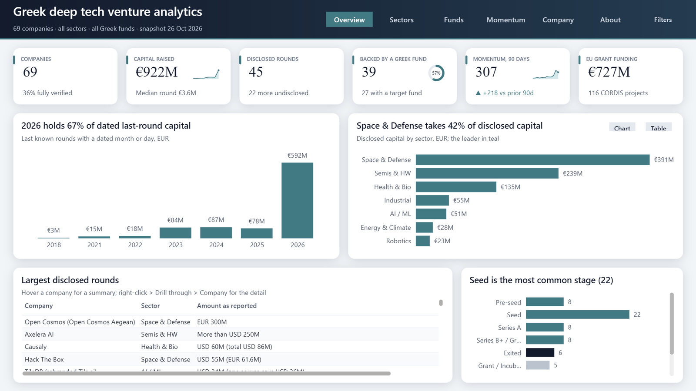
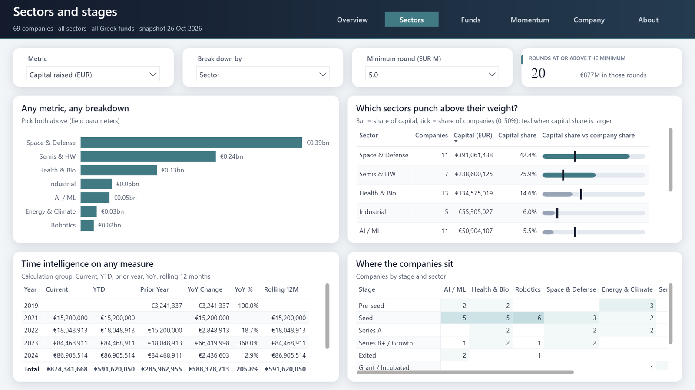
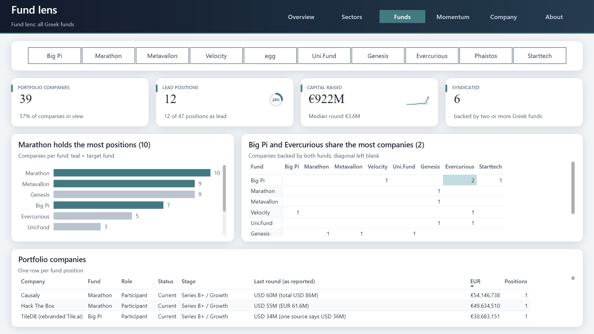
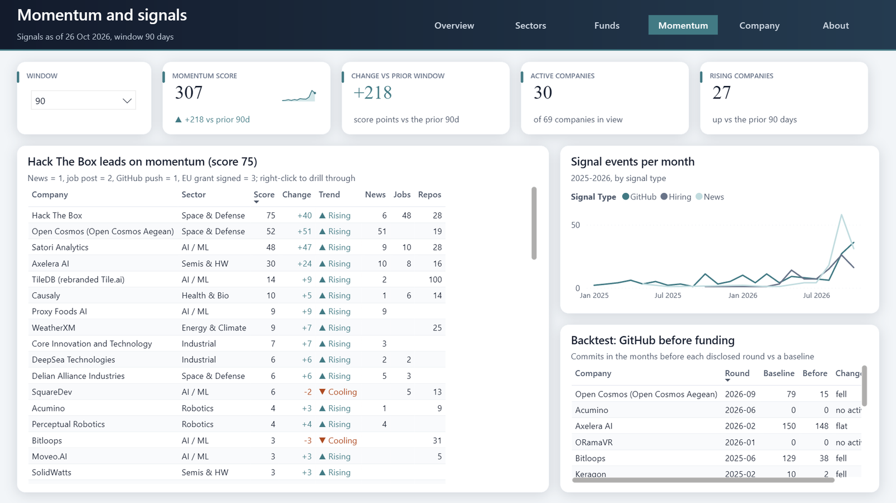
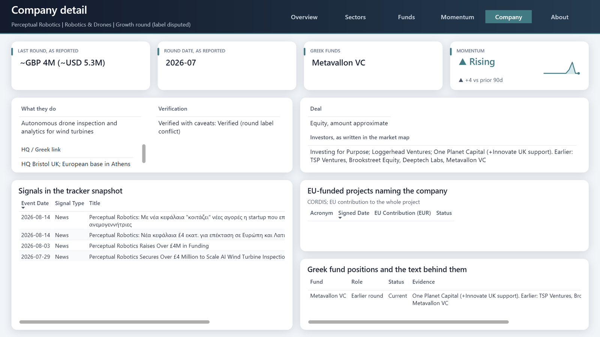
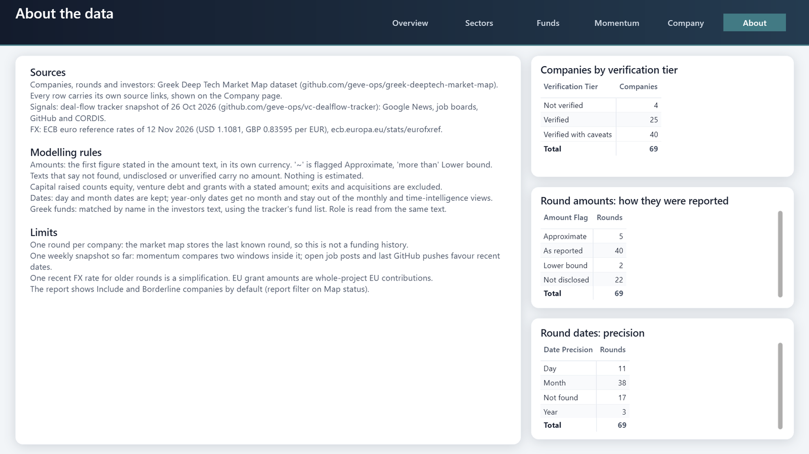
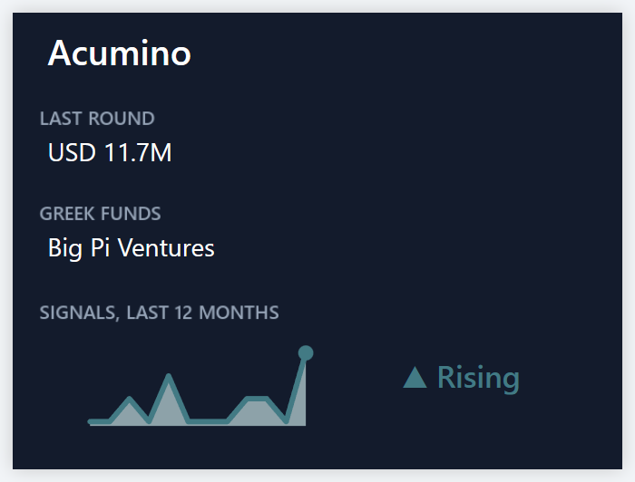
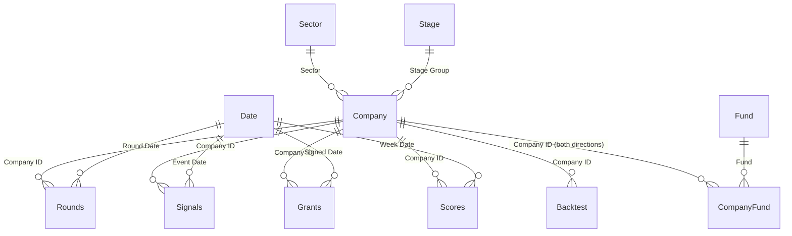

# Greek Deep Tech Venture Analytics (Power BI)

A Power BI model and report on where venture money goes in Greek deep tech, which Greek funds back the same companies, and which companies are showing momentum right now. It is built on public data I collected for two earlier projects, the [Greek Deep Tech Market Map](https://github.com/geve-ops/greek-deeptech-market-map) and the [VC deal-flow tracker](https://github.com/geve-ops/vc-dealflow-tracker). Every company and funding figure traces back to a source link in those datasets.

The project is saved as a **Power BI Project (PBIP)**: the semantic model is plain-text TMDL and the report is PBIR JSON, so every measure, query and visual is reviewable in git.



## What it answers

Figures are for the 69 in-scope companies (marked Include or Borderline in the market map), with rounds converted to EUR at the ECB rates of 12 Nov 2026.

- **Capital is concentrated.** 45 disclosed last rounds add up to €922M, but the median round is €3.6M. Two 2026 rounds, Open Cosmos (EUR 300M) and Axelera AI (more than USD 250M, a lower bound), make up 57% of the total.
- **Space & Defense leads on capital (€391M, 42%), not on company count.** One round, Open Cosmos, is 77% of the sector's total. Robotics and Health & Bio have the most companies (13 each), but Robotics has the smallest capital (€23M).
- **Greek funds back 39 of the 69 companies.** 27 have one of the five target funds (Big Pi, Marathon, Metavallon, Velocity, egg). Marathon has the most positions (10, of which 4 as lead), then Metavallon and Genesis (9 each).
- **Greek funds rarely co-invest.** In the investors text, the only pair that shares more than one company is Big Pi and Evercurious (2). Every other overlap is a single company.
- **Momentum (90-day window to 26 Oct 2026):** Hack The Box has the highest score (75). Open Cosmos (+51) and Satori Analytics (+47) rose most against the 90 days before.
- **EU grants are a second funding channel.** 116 distinct CORDIS projects name these companies, with €727M of EU contribution to those projects in total (whole-project amounts, not the companies' shares).

## Report pages

| Page | What it shows | Techniques |
|---|---|---|
| Overview | Six KPI tiles, capital by round year and sector, stage mix, largest rounds | SVG sparklines and progress ring, insight-headline titles, chart/table toggle and slide-in filter panel (bookmarks), clear-all-slicers button, report-page tooltip |
| Sectors | Any metric by any breakdown; a sector scorecard with bullet charts; time intelligence; stage-by-sector heatmap; round-size threshold | Field parameters, SVG bullet chart, calculation group, what-if parameter, gradient formatting |
| Funds | One fund's portfolio, lead positions, syndication and co-investment overlap with every other Greek fund | Many-to-many bridge, disconnected co-fund table, tile slicer, dynamic titles |
| Momentum | Weighted news, hiring, GitHub and EU-grant events in a sliding window, versus the window before | What-if window, data bars, colour and icon rules, GitHub backtest |
| Company | Profile, last round, investors, signals, EU projects and the text behind each fund match | Drill-through page (opens on Perceptual Robotics) |
| Company tooltip | Last round, Greek funds, 12-month signal sparkline and trend when you hover a company | Dark report-page tooltip |
| About | Sources, modelling rules, limits, and how the amounts and dates were reported | Data-quality tables |

Every page shares a header with a page navigator and a subtitle that reacts to the slicers. The design system (palette, grid, backgrounds, theme, every visual's position, the SVG DAX and a polish checklist) is written up in [docs/design.md](docs/design.md).

| | |
|---|---|
|  |  |
|  |  |
|  |  |

## Data model

A star schema built in Power Query. Facts sit at the edges, dimensions in the middle, and the fund relationship runs through a bridge table because one company can have several Greek funds and one fund many companies.



| Table | Type | Rows | Built from |
|---|---|---|---|
| Company | Dimension | 88 | Market map dataset, merged with the tracker watchlist and pipeline |
| Sector, Stage | Dimensions | 8, 9 | Sectors from the dataset; stage buckets from the free-text stage labels |
| Fund | Dimension | 10 | The tracker's Greek fund list (five target funds plus five others) |
| Date | Dimension | 4,748 | Calendar 2014-2026, marked as the date table |
| Company Fund | Bridge | 58 | Greek fund names matched in each company's investors text |
| Rounds | Fact | 88 | Last known round per company: amount, currency, flag, deal type, date and precision |
| Signals | Fact | 543 | News (128), job postings (100) and GitHub repositories (315) from the tracker snapshot |
| Grants | Fact | 118 | EU-funded projects from CORDIS that name the company (116 distinct projects) |
| Scores, Backtest | Facts | 69, 15 | The tracker's weekly score and its GitHub-before-funding backtest |
| Co-Fund | Disconnected | 10 | Copy of Fund used as the columns of the overlap matrix |
| Time Intelligence | Calculation group | 6 items | Current, YTD, Prior Year, YoY Change, YoY %, Rolling 12M |
| Metric, Breakdown | Field parameters | 6, 5 | Pick the measure and the column a visual shows |
| USD per EUR, GBP per EUR, Momentum Window, Min Round Size | What-if parameters | | FX rates, momentum window length, round-size threshold |

### Power Query

All shaping happens in Power Query (M), in [`expressions.tmdl`](GreekDeepTech.SemanticModel/definition/expressions.tmdl) and each table's partition:

- `fnParseAmount` reads the first `EUR|USD|GBP <number><K|M|B>` in the amount text, flags `~` as *Approximate* and "more than" as *Lower bound*, and returns no amount for texts that say not found, undisclosed or unverified. I checked its output for all 88 rows against a separate script: no differences.
- `fnParseDate` keeps day and month dates. Month-only dates go to the first of the month. Year-only dates get no date, so they never land on a made-up month.
- `fnStageGroup` maps 39 different stage labels onto nine buckets, applying ordered rules.
- The fund bridge splits the investors text into segments, matches the fund names and reads the role from the same segment (Lead, Participant, Earlier round, Sold stake).
- The tracker's JSON snapshot is flattened into the Signals and Grants facts.

### Row-level security

Two demo roles, in [`roles/`](GreekDeepTech.SemanticModel/definition/roles):

| Role | Filter | What it sees |
|---|---|---|
| Fund Partner - Big Pi | `CONTAINSSTRING ( 'Company'[Greek Funds], "Big Pi Ventures" )` | 10 companies, 127 signals |
| Sector Analyst - AI | `'Sector'[Sector] = "AI & Machine Learning"` | 19 companies, 223 signals |

In Power BI Desktop: Modeling > View as > pick a role.

## DAX glossary

| Measure | What it does | Core DAX |
|---|---|---|
| Capital Raised (EUR) | Stated amounts of equity, venture debt and grant rounds, converted to EUR at the what-if FX rates; exits excluded | `SUMX ( FILTER ( Rounds, Rounds[Counts As Capital] ), Rounds[Amount (Native)] / SWITCH ( Rounds[Currency], "EUR", 1, "USD", usd, "GBP", gbp ) )` |
| Disclosed Rounds | Rounds with a stated amount, exits excluded | `CALCULATE ( COUNTROWS ( Rounds ), Rounds[Counts As Capital] = TRUE () )` |
| Median Round / Largest Round (EUR) | Typical and largest disclosed round | `MEDIANX` / `MAXX` over the same row expression |
| Capital Share % | Share of the capital in the current selection | `DIVIDE ( [Capital Raised (EUR)], CALCULATE ( [Capital Raised (EUR)], ALLSELECTED () ) )` |
| Rounds Above Threshold | Disclosed rounds at or above the Min Round Size what-if value | `COUNTROWS ( FILTER ( Rounds, ... >= [Min Round Size Value] * 1000000 ) )` |
| Greek Fund Backed Companies | Companies with at least one Greek fund in their investors text | `DISTINCTCOUNT ( 'Company Fund'[Company ID] )` |
| Lead Positions / Lead Share % | Fund positions where the investors text marks the fund as lead | `CALCULATE ( COUNTROWS ( 'Company Fund' ), 'Company Fund'[Role] = "Lead" )` |
| Shared Portfolio Companies | Companies backed by both the row fund and the column fund | `COUNTROWS ( INTERSECT ( rowFund, colFund ) )`, with the column fund applied via `TREATAS ( VALUES ( 'Co-Fund'[Co-Fund] ), 'Fund'[Fund] )` |
| Co-Investments | Shared Portfolio Companies with the diagonal left blank, for the heatmap | `IF ( SELECTEDVALUE ( 'Fund'[Fund] ) <> SELECTEDVALUE ( 'Co-Fund'[Co-Fund] ), [Shared Portfolio Companies] )` |
| Portfolio Overlap % | Jaccard overlap of two portfolios | `DIVIDE ( COUNTROWS ( INTERSECT ( a, b ) ), COUNTROWS ( DISTINCT ( UNION ( a, b ) ) ) )` |
| EU Grant Funding (EUR) | EU contribution per distinct project, so a project linked to two companies counts once | `SUMX ( VALUES ( Grants[Project ID] ), CALCULATE ( MAX ( Grants[EU Contribution (EUR)] ) ) )` |
| Weighted Signals | News = 1, job posting = 2, GitHub push = 1 | `SUMX ( Signals, SWITCH ( Signals[Signal Type], "News", 1, "Hiring", 2, "GitHub", 1, 0 ) )` |
| Momentum Score | Weighted signals in the last N days before the snapshot, plus 3 per EU grant signed in that window | `CALCULATE ( [Weighted Signals], REMOVEFILTERS ( 'Date' ), Signals[Event Date] > asOf - w, Signals[Event Date] <= asOf ) + 3 * grants` |
| Momentum Score (Prior Window) / Change / Trend | The same score for the N days before; the difference; Rising, Cooling, Steady or Quiet | window shifted by `w` days |
| Momentum Rank | Dense rank among the companies in view | `RANKX ( ALLSELECTED ( 'Company' ), [Momentum Score], , DESC, DENSE )` |
| Time Intelligence (calculation group) | Applies to any measure: Current, YTD, Prior Year, YoY Change, YoY % (own format string), Rolling 12M | `CALCULATE ( SELECTEDMEASURE (), DATESYTD ( 'Date'[Date] ) )` and so on |
| Metric / Breakdown (field parameters) | Let the reader choose the measure and the column of the Sectors chart | `NAMEOF ( 'Key Measures'[Capital Raised (EUR)] )` and so on |
| USD per EUR Value, GBP per EUR Value | What-if FX rates; default to the ECB reference rates of 12 Nov 2026 | `SELECTEDVALUE ( 'USD per EUR'[USD per EUR], 1.1081 )` |
| Fund Lens Title, FX Note, As-Of Label, Company Header | Dynamic titles and notes | string measures with `SELECTEDVALUE` and `FORMAT` |

Measures that feed tables return BLANK, not 0, for combinations that do not exist (for example a company and a sector it is not in). This stops multi-table visuals from cross-joining. The momentum measures check `ISEMPTY ( 'Company' )` for the same reason. All 88 measures (48 analytical, 40 for the design: SVG visuals, colour rules, KPI context lines and dynamic titles), with descriptions and display folders, are in [`Key Measures.tmdl`](GreekDeepTech.SemanticModel/definition/tables/Key%20Measures.tmdl).

## Limits of the data

- **One round per company.** The market map stores each company's last known round, not its funding history. The year chart shows when last rounds happened, not how much was invested each year, and time intelligence works on those dates.
- **One weekly snapshot.** The tracker has one snapshot so far (26 Oct 2026). Momentum compares two windows inside it. Open job posts and last GitHub pushes lean towards recent dates, so older windows look quieter than they were.
- **Amounts as reported.** 7 of 45 of disclosed rounds are approximate or lower bounds, and 22 of the in-scope companies have no stated amount. Nothing is estimated or filled in.
- **FX.** Rounds are converted to EUR at the ECB reference rates of 12 Nov 2026 (USD 1.1081 and GBP 0.83595 per EUR; [source](https://www.ecb.europa.eu/stats/eurofxref/eurofxref-daily.xml), copy in `data/`). Using one recent rate for older rounds is a simplification; the what-if sliders show how sensitive the totals are to it.
- **EU grants** are the EU contribution to the whole project from CORDIS, not the company's share. A project is linked to a company when the company's name appears in the project text.
- **Greek fund matches** come from fund names in the investors text. egg / Eurobank is a target fund but no company in the dataset names it, so it shows no positions.
- **Scope.** By default the report shows companies marked Include or Borderline in the market map (69 of 88). The rest are not Greek or not deep tech; remove the report filter to see them.

## Open it

1. Install [Power BI Desktop](https://www.microsoft.com/power-bi/desktop) (Windows).
2. Clone the repo and open `GreekDeepTech.pbip`.
3. If the repo is not in `C:\Users\gevel\Documents\greek-deeptech-powerbi`, change the `DataFolder` parameter (Transform data > Manage parameters) to your `data\` folder.
4. Select **Refresh**. The data cache is not stored in git, so the first open shows empty visuals until you refresh.

## Repository layout

```
GreekDeepTech.pbip                 Power BI Project entry point
GreekDeepTech.SemanticModel/       TMDL: tables, Power Query, measures, relationships, roles
GreekDeepTech.Report/              PBIR: pages, visuals, theme (StaticResources/RegisteredResources/GreekDeepTech.json)
data/                              Source snapshots: market map dataset, tracker files, ECB rates
docs/screenshots/                  Report screenshots
```

## Sources

- Greek Deep Tech Market Map dataset, verified 16 Oct 2026: `data/greek_deeptech_dataset.csv`, one source link per company in `source_link`.
- VC deal-flow tracker, snapshot of 26 Oct 2026: `data/watchlist.csv`, `scores.csv`, `backtest.csv`, `pipeline.csv`, `snapshot_2026-10-26.json` (Google News, job boards, GitHub, CORDIS).
- European Central Bank euro reference rates, 12 Nov 2026: `data/ecb_eurofxref_2026-11-12.xml`.
